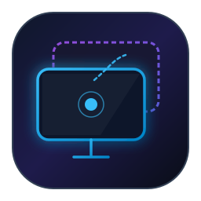

# ZenDisp

<p align="center">
  
</p>

<p align="center">
  <b>High-Performance Virtual Displays and Picture-in-Picture Studio for macOS</b><br />
  Create custom virtual screens, tile multi-monitor coding layouts, and stream with zero-latency GPU acceleration.
</p>

<p align="center">
  <a href="https://github.com/SamSeenX/ZenDisp/releases/latest"><b>Download ZenDisp.dmg (Latest Release)</b></a>
</p>

---

## Highlights

* **Instant Virtual Monitors:** Spawn custom virtual screens up to 4K with customized aspect ratios and refresh rates.
* **Per-Display HiDPI Control:** Toggle between crisp 2x Retina rendering and native 1x Standard DPI independently for each monitor.
* **Zero-Copy GPU Streaming:** Smooth 60 FPS Picture-in-Picture windows powered by ScreenCaptureKit and zero-copy IOSurface CALayer rendering.
* **Developer Coding Suite:** Preconfigured multi-screen arrangements including a 3:2 coding canvas paired with a 9:16 narrow tall vertical screen for documentation and continuous terminal logs.
* **Fluid Cursor Teleportation:** Click inside any floating PiP window to snap your hardware mouse directly onto that virtual display. A simple three-finger swipe between Spaces releases your cursor back to your primary screen automatically.
* **Persistent Window Geometry:** Remembers your exact window placement and resize scaling across sessions, returning automatically to your preferred arrangement.
* **Auto-Disconnect Lifecycle:** Virtual displays automatically disconnect and terminate from macOS WindowServer the moment you close their floating PiP stream window.
* **Pure Native Swift:** Zero third-party dependencies, under 30 MB memory footprint, and fully optimized for Apple Silicon and modern macOS.

---

## Download and Installation

### 1. Download Precompiled DMG
Download the ready-to-run disk image directly from the Releases page:

**[Download Latest ZenDisp.dmg](https://github.com/SamSeenX/ZenDisp/releases/latest)**

### 2. Install to Applications
1. Open `ZenDisp.dmg`.
2. Drag **ZenDisp.app** into your **Applications** folder.
3. Launch ZenDisp from your Applications folder or Spotlight (`⌘Space`).

### 3. Permissions Setup
On initial launch, macOS will request:
* **Screen Recording:** Required by Apple ScreenCaptureKit to stream virtual displays into floating PiP windows.

---

## Keyboard Shortcuts

| Shortcut | Action | Description |
| :--- | :--- | :--- |
| `⌃ ⎋` (Control + Escape) | **Release Cursor** | Instantly teleports your pointer back to your primary screen center |
| `⌥ ⌘ ⌃ R` | **Panic Reset** | Emergency reset that releases stuck input and restores default window tiling |
| Three-Finger Swipe | **Auto-Release** | Swiping between macOS Spaces frees the cursor automatically |
| Click in PiP | **Snap to Display** | Snaps hardware mouse directly to that virtual monitor coordinate space |

---

## Multi-Screen Layout Groups

ZenDisp includes curated multi-screen layouts that launch with a single click:

* **Side-by-Side Dual Workstation (1:1):** Spawns two equal 1080p widescreen monitors tiled side-by-side.
* **Developer Coding Suite:** Opens a 3:2 coding IDE display on the left and a 9:16 vertical portrait screen on the right for full-page code review and terminal streaming.

---

## Building from Source (Optional)

ZenDisp compiles entirely with standard macOS command-line tools without requiring the full Xcode IDE:

```bash
git clone https://github.com/SamSeenX/ZenDisp.git
cd ZenDisp
./scripts/build_app.sh
```

To build a distributable `.dmg`:

```bash
./scripts/create_dmg.sh
```

---

## System Requirements

* macOS 13.0 (Ventura) or later
* Apple Silicon (M1/M2/M3/M4) or Intel Mac

---

## License

MIT License. Designed and maintained by SamSeenX.
